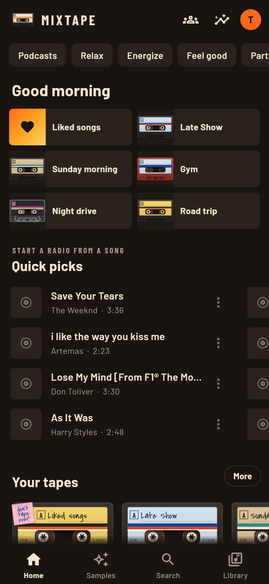
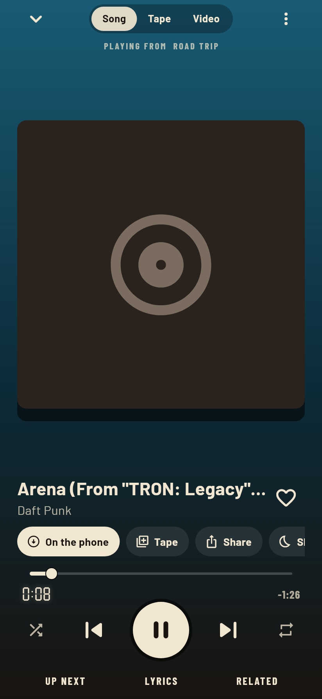
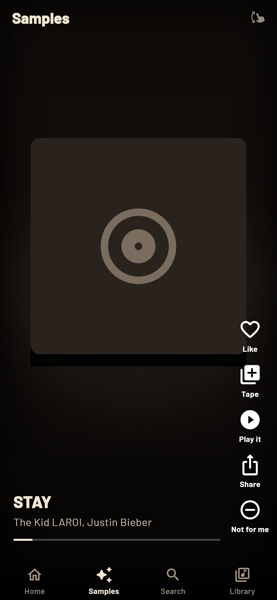
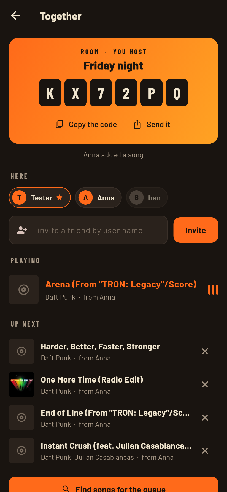
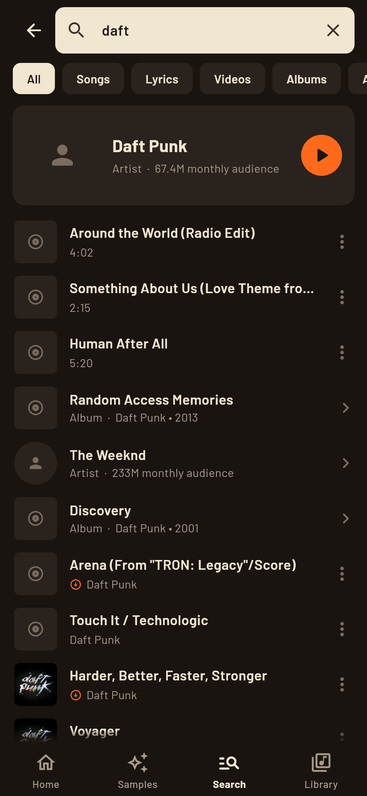
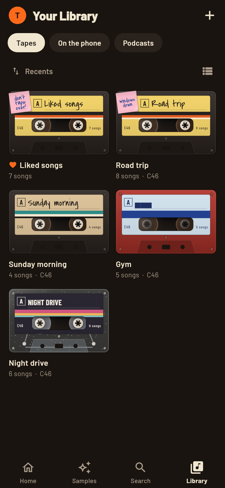
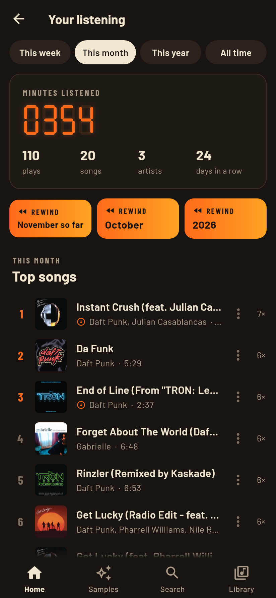

# Mixtape for the phone

Your tapes from Mixtape on the computer, in your pocket, on Android and on the iPhone. Sign in with your
Mixtape Account and your tapes (with their shells, label papers, stickers and sticky notes) and your
liked songs come over; whatever you change on the phone goes back.

It's laid out the way YouTube Music and Spotify do it, in Mixtape's colors: shelves and quick picks on
Home, Samples to find new music, a search that helps while you type, and a library of cassettes.

| Home | Playing | Samples | Together |
| --- | --- | --- | --- |
|  |  |  |  |
| **Search** | **Your library** | **Your listening** | **Wrapped** |
|  |  |  |  |

<sub>Taken fresh by every build (the `screens` branch), with the app's own fonts and YouTube Music's
answers from `test/fixtures`.</sub>

## Install

**Android 7 or newer:** grab `Mixtape-<version>.apk` from the [releases](../../releases), open it on the
phone and allow the install. (A phone from before 2017 or so may need `Mixtape-<version>-older-phones.apk`.)

**iPhone:** the releases have `Mixtape-<version>.ipa`, built without a signature (there's no App Store
version). Sign it on its way onto the phone with your own Apple ID, using
[AltStore](https://altstore.io), [SideStore](https://sidestore.io) or [Sideloadly](https://sideloadly.io).
With a free Apple ID the signature lasts seven days, and AltStore or SideStore renew it by themselves.

## What's in it

- **Home**: shortcuts to what you play most, quick picks (songs like the ones you played lately), your
  tapes, mixes made for you, listen again, and the shelves of YouTube Music's own home page.
- **Search** that finds things: words offered while you type, what you searched before, a top result,
  filters for songs, videos, albums, artists and playlists, and pages for every artist and album.
- **The player**: the song, its tape or its music video (lined up with the song by YouTube's "most
  replayed" curve, and over the whole screen with the phone on its side; with no music video, the
  artist's lyric video or visualizer), lyrics that scroll along (from lrclib, YouTube Music,
  Megalobiz, NetEase, KuGou or QQ Music; tap a line to jump there, a little clock counts down to the
  next one, Translate puts them into your language), what comes next, related songs, a sleep timer (in
  minutes or at the end of the song) and the speed. Swipe the little player for the next song, and save
  the queue as a tape. Every artist's name opens the artist.
- **Between songs**: a crossfade in the computer's four shapes (smooth, linear, DJ, gentle), albums
  that play straight through, and a radio that keeps going with songs like the last ones (the songs,
  not their videos). Every song has "Songs like this" and a radio, every artist a radio and Samples.
- **Samples**: one song at a time on the whole screen, from its best half minute; then the next one
  comes by itself and the two run into each other, or you flick on sooner. Like it, put it on a tape,
  play it whole or say it's not for you. The music that was on waits and carries on after.
- **On the phone**: save a whole tape, an album or a single song for when there's no internet. The
  Downloads page shows the song coming down, the ones waiting their turn and any that wouldn't come;
  Settings show how much room they take.
- **Together**: listen along with a friend by their user name, open a room with one queue for everybody,
  or throw a party where the guests ask for songs and the host picks. These are the same rooms as on
  the computer, so phones and computers can sit in one.
- **Your tapes**, drawn like on the computer, with the tape studio for the shell, the label, the reels
  and the sticky note, and everything to stick on them: stickers from the sticker sheet, photos,
  sticky notes, washi tape, label-maker strips and the pen. What's stuck on a tape shows on the
  computer too, and the other way round. Pin tapes to the top, sort them, see them as a list or as
  cassettes.
- **Add music**: playlists from Spotify, YouTube, YouTube Music and Deezer (or a CSV file, or a list of
  songs) become tapes; podcasts come in with their newest episodes; music files on the phone play
  right away (also opened with Mixtape from the files app, or shared to it).
- **Your listening**: minutes, top songs and artists, the hours you listen at, your streak, and Rewind
  for this month, last month and the year, told in cards you tap through and ending on a J-card to
  share or turn into a tape. What you play can go to ListenBrainz.
- **Profiles**: yours with a picture, your pronouns, a few lines, your color and a song and a tape on
  show; anyone else's to look up, listen along with or invite.
- **Your library in a file**: the same file as the computer's Export library (Ctrl+E there), saved
  from Settings or taken in from one.
- **Not interested**: a song you don't want stops coming up in mixes, radios and Samples.
- **Widgets**: Cassette, Now playing, Cover, My tapes and a mini player for the home screen on Android;
  the first four on the iPhone too, and the mini player on its lock screen.
- **A keyboard** (Samsung DeX, a tablet, a Chromebook) has the computer's keys: Space plays or pauses,
  Ctrl+Left and Ctrl+Right jump, Ctrl+F searches, Ctrl+P opens the player, Ctrl+N makes a tape,
  Alt+Left goes back, Ctrl+E and Ctrl+I save or take in the library, Ctrl+Shift+L is Listen together.
- Keeps playing with the screen off, with its keys in the notification, on the lock screen, on
  headphones and on the widgets. Picks up where you left off. On Android 13 and newer the music card
  has two more keys next to play, picked in Settings: the heart, shuffle, repeat, Not for me or Stop
  after this song (a podcast has 10 seconds back and 30 ahead there). A tap on the card opens the big
  player.

Not on the phone: Cass, the DJ from the computer (it runs a language model on the computer itself),
the song pop-up and the mini player window, which are the computer's own. Songs a tape got from
SoundCloud play on the computer only.

## How it's built

Flutter for the screens, [just_audio](https://pub.dev/packages/just_audio) and
[audio_service](https://pub.dev/packages/audio_service) for playing in the background,
[video_player](https://pub.dev/packages/video_player) for the music videos, and
[NewPipe Extractor](https://github.com/TeamNewPipe/NewPipeExtractor) on the Android side (in
`packages/mixtape_native`) for the addresses of songs and videos. On the iPhone, and on Android when
NewPipe can't, `lib/innertube.dart` asks YouTube Music directly, the way its own apps do;
`lib/music.dart` reads what comes back (search, home, artists, albums, radios, lyrics). The Android
widgets are plain app widgets, drawn in Kotlin. The iPhone's are WidgetKit (`ios-extras/widgets`),
added to the project Flutter makes by `ios-extras/add_widgets.rb`; their keys run inside the app.

YouTube addresses run out after a few hours, so a song's bytes come through a small reader in
`lib/audio.dart` that looks the address up again when YouTube stops taking it and carries on where a
dropped connection left off. It reads a few minutes ahead and then only a little faster than the music
plays, so long songs don't pile up in memory.

Rooms follow the same rules as on the computer (`lib/rooms.dart` is `rooms.py` in Dart) and talk
through the Mixtape Account's Supabase, its database for the room and Realtime for who's there.

Every push to `main` is checked (`flutter analyze`, `flutter test`), built and released by
`.github/workflows/android.yml`; other branches get the checks from `check.yml`. The tests open every
page of the app with YouTube Music answering from the files in `test/fixtures` (see `test/box.dart`),
and with `--dart-define=PICTURES=true` they take the pictures above.

## Building it yourself

```sh
flutter create --platforms=android --org dev.softwarevault --project-name mixtape .
flutter build apk --release
```

The first line only adds the files Flutter makes for every Android app (the Gradle wrapper); nothing
here is overwritten. For the iPhone, on a Mac:

```sh
flutter create --platforms=ios --org dev.softwarevault --project-name mixtape .
bash ios-extras/setup.sh
flutter build ios --release --no-codesign
```

`setup.sh` puts in the app's icon, its settings and the widgets.

## License

GPL 3, see [LICENSE](LICENSE). NewPipe Extractor is GPL 3 as well. The fonts (Barlow and Covered By
Your Grace) come with their own OFL licenses in `assets/fonts`.
